# Sinkhole Screens

Touchscreen dashboards for a Raspberry Pi running [Pi-hole](https://pi-hole.net) v6: 22 designs to pick from on the screen, and a printable case to put it in.

New to Pi-hole? It's free software that blocks ads and trackers for every device in your home by acting as a *DNS sinkhole*: when a device looks up an ad or tracking address, it gets told "nowhere". It runs well on a Raspberry Pi. Sinkhole Screens adds a touchscreen so you can see it working.

**[Try every design live at sinkholescreens.com →](https://sinkholescreens.com)** (made-up numbers, no Pi-hole needed)

| | | | |
| --- | --- | --- | --- |
| 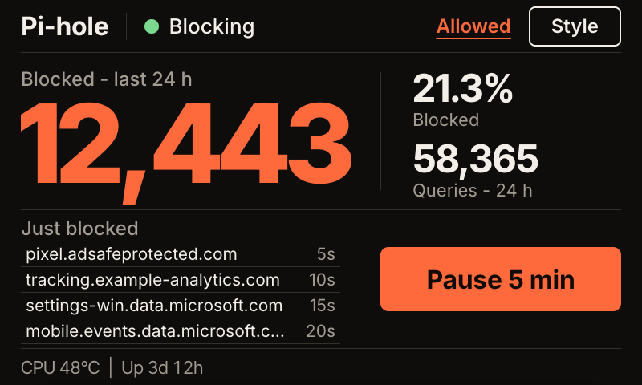 Monolith | 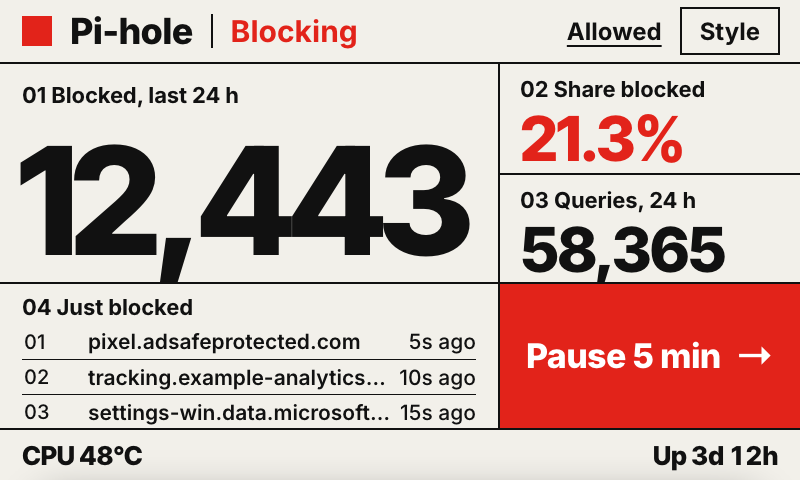 Swiss | 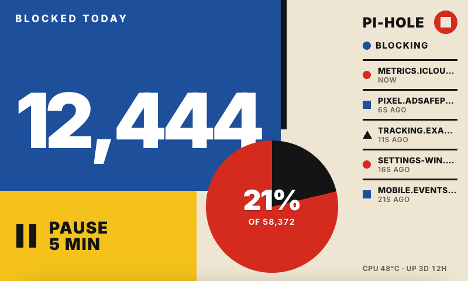 Bauhaus | 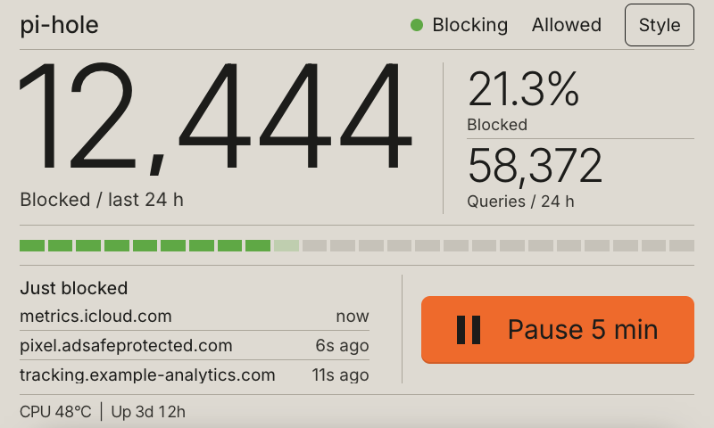 Hi-Fi |
| 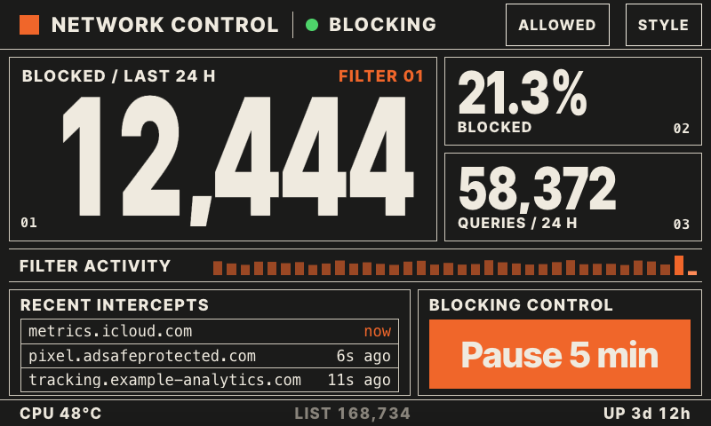 Mission Control | 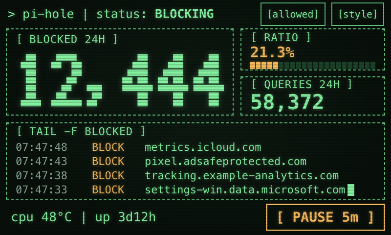 Terminal | 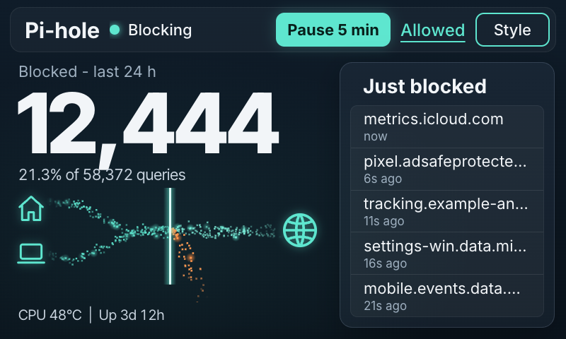 Flow | 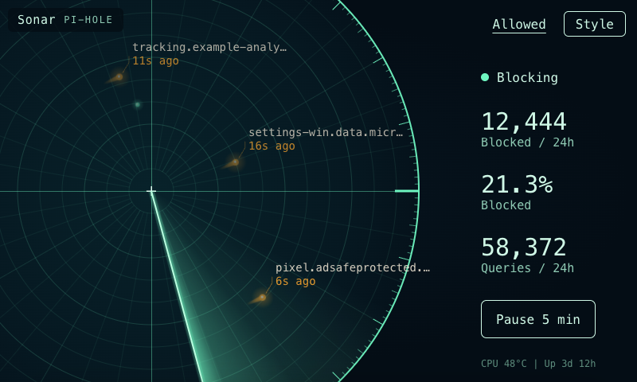 Sonar |
| 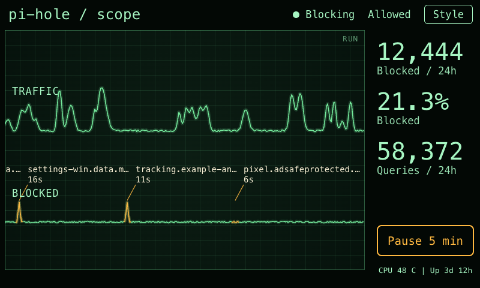 Echo | 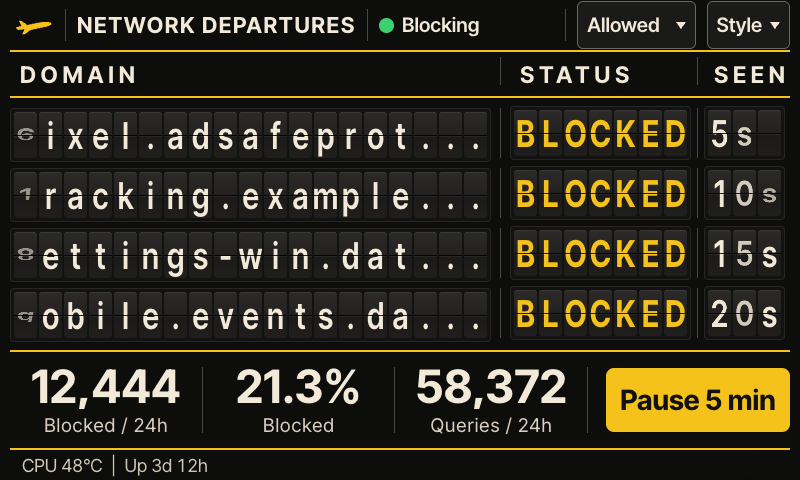 Airport Departures | 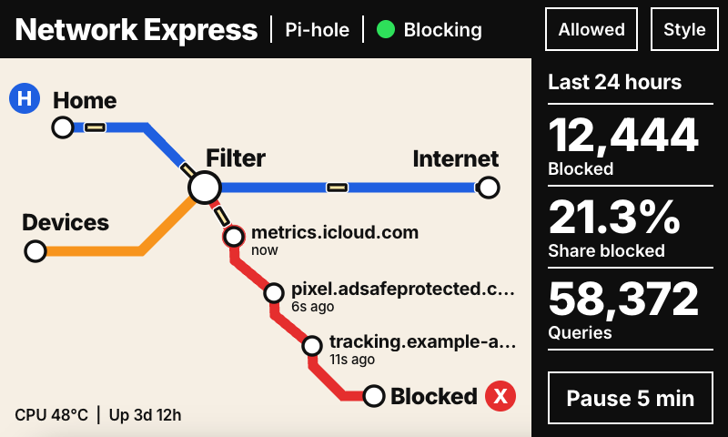 Network Express | 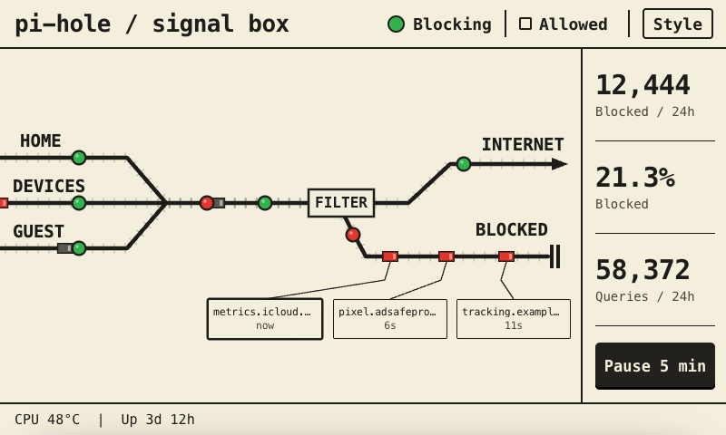 Signal Box |
| 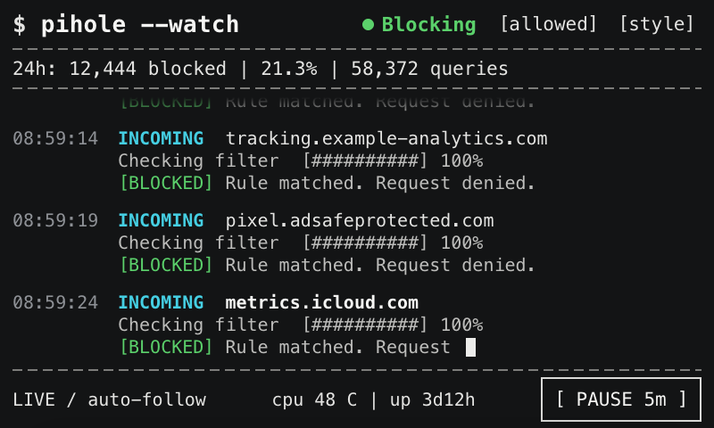 Live Terminal | 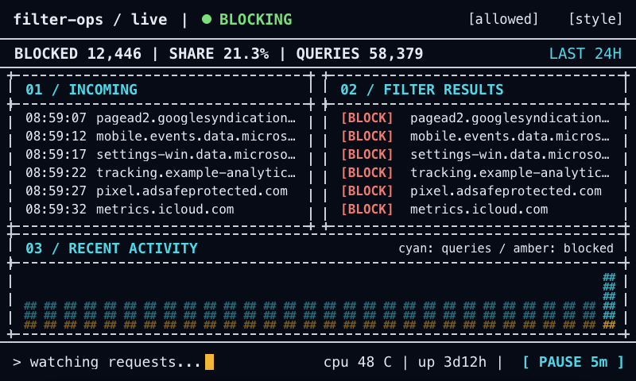 Filter Ops | 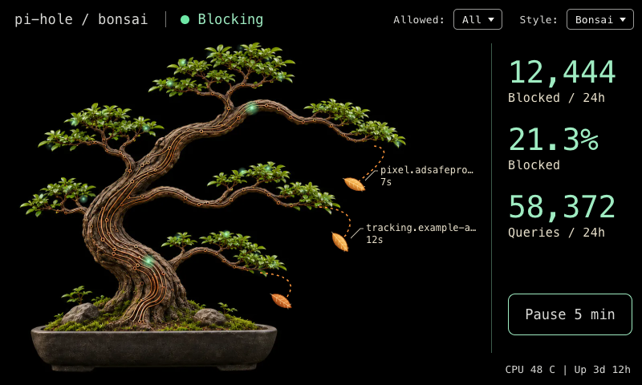 Bonsai | 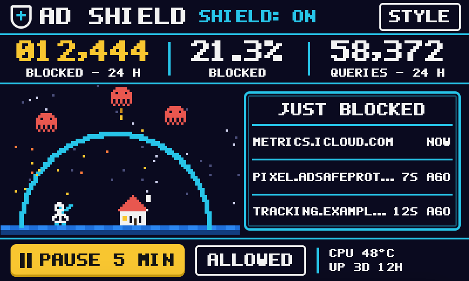 8-bit |
| 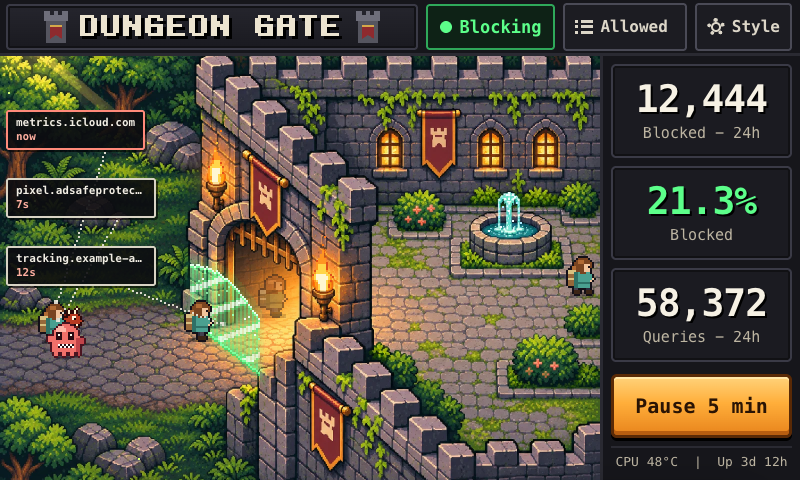 Dungeon Gate | 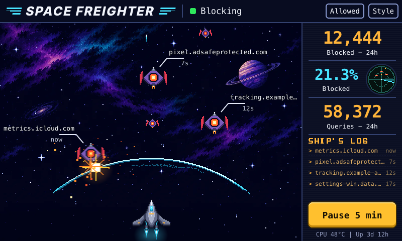 Space Freighter | 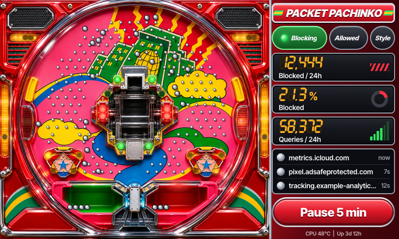 Pachinko | 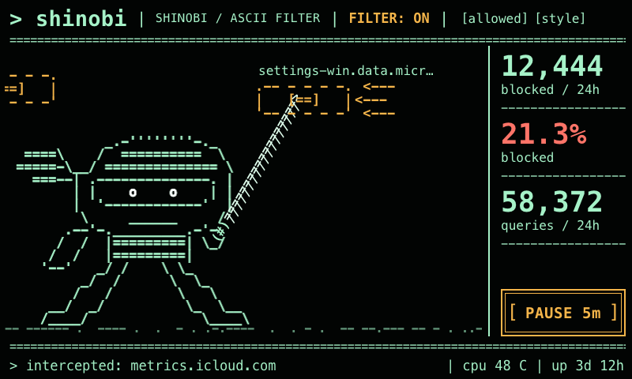 ASCII Ninja |
| 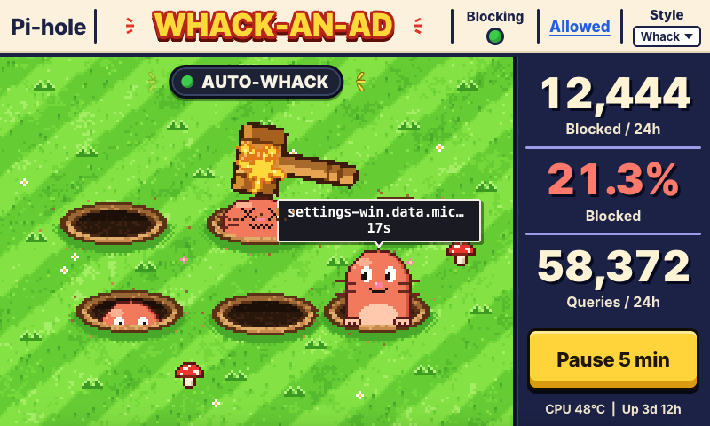 Whack-an-Ad | 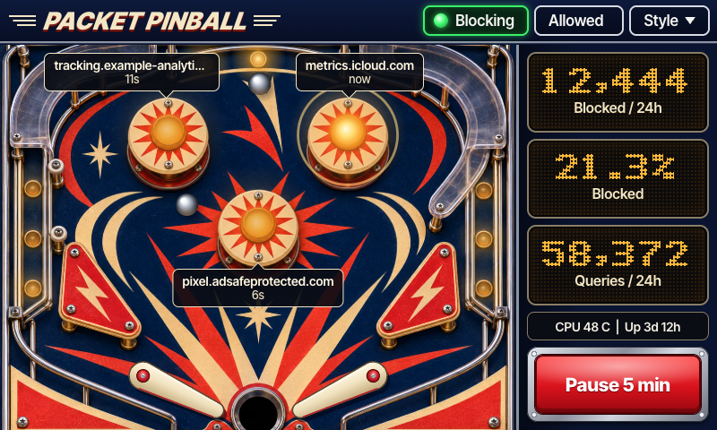 Packet Pinball |  |  |

## What it does

- Shows queries blocked in the last 24 h, the blocked share, total queries and the domains just blocked.
- **Pause** blocking for 5 minutes with one tap, and resume early.
- Tap a blocked domain to see why it was blocked (which list, exact or wildcard) and how often today. Then **allow it for 1 hour** or **always**, with a press and hold so it can't happen by accident, and an 8-second Undo.
- **Allowed** lists what you let through from the screen, with countdowns, and lets you remove entries.
- **Style** picks one of the 22 designs. The choice is saved on the Pi.
- Keeps showing the last numbers (dimmed, with their age) if Pi-hole stops answering.

It never changes Pi-hole's own settings or restarts it. The only things it writes are allow-list entries you ask for, each tagged `pihole-dash` so you can see them in the web admin.

## Live demo

The repo is also a static website: `index.html` shows all 22 designs and runs one live. Open `app/index.html?demo` and the dashboard answers its own API calls in the browser with made-up numbers (`app/demo.js`). Pause, Allow and Undo all work on that fake data. The kiosk never uses `?demo`.

To run it locally: `python3 -m http.server 8000` in the repo folder, then open <http://localhost:8000/>.

## You need

- A Raspberry Pi running **Pi-hole v6** (the dashboard uses the v6 API and an app password)
- Raspberry Pi OS **with the desktop** (Bookworm or later, Wayland/labwc) and Chromium
- A touchscreen. The designs are laid out for **800×480**.

## Start from a fresh Pi

Already running Pi-hole on a Pi with the desktop and the screen working? Skip to [Install](#install). Otherwise, about 30 minutes:

1. **Flash the card.** In [Raspberry Pi Imager](https://www.raspberrypi.com/software/), pick *Raspberry Pi 4*, then *Raspberry Pi OS (64-bit)*, the version **with desktop**, then your microSD card. When it offers to customise settings, set:
   - a hostname, e.g. `pihole`;
   - a username and password;
   - your Wi‑Fi (Ethernet is better for a DNS server if you can);
   - your time zone;
   - under *Services*, **enable SSH**.
2. **Connect the screen with the Pi unplugged.** Put the screen's ribbon into the Pi's **DISPLAY** port (not CAMERA), contacts the right way round per the screen's manual. Then insert the card and power on. The desktop appears on the touchscreen; no driver is needed.
3. **Log in over SSH from your computer:** `ssh <username>@pihole.local`.
4. **Make sure it boots straight to the desktop:** `sudo raspi-config` → *System Options* → *Boot / Auto Login* → *Desktop Autologin*. The dashboard runs in that desktop session.
5. **Update:** `sudo apt update && sudo apt full-upgrade -y`, then `sudo reboot`.
6. **Give the Pi a fixed address.** In your router's settings, reserve its current IP address for the Pi (often called *DHCP reservation*). A DNS server that changes address breaks your internet.
7. **Install Pi-hole v6:** `curl -sSL https://install.pi-hole.net | bash` and follow the prompts. Set the web admin password with `pihole setpassword`. The admin page is at `http://pihole.local/admin`.
8. **Point your network at it.** In your router, set the DNS server to the Pi's address, so every device uses Pi-hole (if your router can't, use Pi-hole's own DHCP server instead). Pi-hole's guide covers the options: [Making your network take advantage of Pi-hole](https://docs.pi-hole.net/main/post-install/#making-your-network-take-advantage-of-pi-hole). Keep a way back: if the Pi is ever off, set the router's DNS back to *Automatic* and the internet works again.
9. Carry on with **Install** below.

**Booting from an SSD** (optional, for the NVMe board): once everything works on the card, copy it to the drive with *SD Card Copier* on the desktop (*Accessories*). Set the boot order with `sudo raspi-config` → *Advanced Options* → *Boot Order* → *NVMe/USB Boot*, shut down, remove the card and power on.

## Install

> **Building the case?** Do the software on the bench first, before the Pi goes into the shell: the shell seals in the microSD slot and HDMI ports. The website's assembly guide has this as its step 6.

On the Pi:

```bash
git clone https://github.com/gsylvest/pihole-dash-themes.git
```

```bash
cd pihole-dash-themes && sudo ./install.sh
```

Run it as your normal desktop user with `sudo`, not from a root shell: it uses `$SUDO_USER` to set up the kiosk on your desktop. It:

1. creates a system user `pihole-dash` with no login and no home;
2. copies the page to `/opt/pihole-dash/www` and the backend to `/opt/pihole-dash/backend`;
3. installs and starts `pihole-dash.service` (localhost only, port 8088);
4. installs `/usr/local/bin/pihole-dash-kiosk` and a desktop autostart entry, so Chromium opens the dashboard full screen at login.

Running it again updates everything in place.

### App password

The screen shows **Needs setup** until it has a Pi-hole app password. Use an app password, never your admin password.

1. In Pi-hole's web admin, open **Settings → Web interface / API**. Switch the page to **Expert** if you don't see the app password option.
2. Click **Configure app password**, copy the password it shows once, then enable / save it. This signs out other web sessions.
3. On the Pi, run this and paste the password when asked:

```bash
read -rs -p "Paste app password: " P; echo; printf '%s' "$P" | sudo tee /etc/pihole-dash/app-password >/dev/null; unset P; sudo chmod 600 /etc/pihole-dash/app-password; sudo systemctl restart pihole-dash
```

Check it: `curl -s http://127.0.0.1:8088/api/state | head -c 60` should start with `{"status": "ok"`. If the screen says **App password rejected**, make a new one and save it again.

## Optional: screen sleeps when nobody's there

With an HLK-LD2410C radar sensor wired to the Pi, the screen turns off when the room is empty and wakes when someone walks up (or touches it).

| LD2410C | Pi header pin |
| --- | --- |
| VCC | 2 (5 V) |
| GND | 14 |
| OUT | 16 (GPIO 23) |

Install with the sensor support switched on:

```bash
sudo PRESENCE=1 ./install.sh
```

It fails open: with no sensor, or a loose wire, the screen just stays on. Settings (how long before it sleeps, which pin) are in `/etc/default/pihole-presence`. If it keeps seeing someone in an empty room, lower its range in Hi-Link's phone app.

## Build the case

The [`enclosure/`](enclosure/) folder has a printable desk case for the Pi 4, the 4.3" screen, an optional NVMe board and the radar: print files (Bambu 3MF and STL), print settings, the screws you need and step-by-step assembly. See [enclosure/README.md](enclosure/README.md), and the parts list with a 3D preview at [sinkholescreens.com](https://sinkholescreens.com/#build).

## Day to day

| Command | What |
| --- | --- |
| `pihole-dash-kiosk off` / `on` | Turn the full-screen dashboard off (stays off after reboot) or back on. DNS is never affected. |
| `pihole-dash-kiosk restart` | Reload the screen |
| `pihole-dash-kiosk status` | Is it on and running? |
| `systemctl status pihole-dash` / `journalctl -u pihole-dash` | Backend status and logs |

If your case's bezel hides the top of the screen, change the kiosk URL in `/usr/local/bin/pihole-dash-kiosk` to `http://127.0.0.1:8088/?top=24` (pixels to keep clear) and run `pihole-dash-kiosk restart`. The dashboard shrinks slightly and sits at the bottom. The setting is remembered, and `?top=0` turns it off.

## How it works and security

```
Chromium kiosk  ──►  pihole-dash on 127.0.0.1:8088  ──►  Pi-hole API on 127.0.0.1
 no secrets           holds the app password and session
```

- **The password stays out of the browser.** `/etc/pihole-dash/app-password` is root-only (mode 600). systemd hands a private copy to the service at start (`LoadCredential`). The page never sees the password or the session.
- **Localhost only.** The backend binds to `127.0.0.1` and the unit allows no other network traffic.
- **Hardened service.** It runs as an unprivileged user with a read-only system, no home directories, no new privileges and a 96 MB memory cap.
- **Writes are narrow.** Pause, resume and allow need a custom header and a same-origin request, so another web page can't trigger them. Domains are validated before they reach Pi-hole. The dashboard only edits allow entries it created (tagged `pihole-dash`). Entries you added in the web admin are left alone.
- **Python standard library only**, no `pip install`. The page is plain HTML, CSS and JavaScript with no build step, and loads nothing from the internet.

Timed allows aren't built into Pi-hole, so each one carries `pihole-dash until=<time>` in its comment. The backend checks every 30 s and removes expired ones. This survives restarts and reboots.

## Make your own design

Each design in `app/themes/` is two files, `<id>.js` and `<id>.css`. The JavaScript registers itself:

```js
window.PiSkins.add("myid", {
  mount(el) { /* build the DOM once */ },
  render(el, m) { /* called about every second with the latest numbers */ },
  unmount() { /* stop animations */ },
}, "My Design", "One-line description", thumbnailSvg);
```

`m` holds the numbers (`m.data.blocked`, `m.data.total`, `m.data.percent_blocked`), `m.ticker` (recently blocked domains), `m.paused` and more. Add your id to the list in `app/theme.js` and your two files to `app/index.html`. Copy an existing design to start; `hifi` and `mission` are short. Test with `?demo&theme=myid`.

To use the existing screenshot script, run `python3 -m http.server 8767` and then `node dev/shoot.mjs site/shots myid`. It needs Google Chrome.

## Uninstall

```bash
pihole-dash-kiosk off
```

```bash
sudo systemctl disable --now pihole-dash pihole-presence 2>/dev/null; sudo rm -f /etc/systemd/system/pihole-dash.service /etc/systemd/system/pihole-presence.service /etc/default/pihole-presence && sudo systemctl daemon-reload
```

```bash
sudo rm -rf /opt/pihole-dash /etc/pihole-dash /usr/local/bin/pihole-dash-kiosk ~/.config/autostart/pihole-dash-kiosk.desktop ~/.local/share/pihole-dash ~/.config/pihole-dash && sudo userdel pihole-dash
```

Allow entries made from the screen stay in Pi-hole. Remove them in the web admin (search for the comment `pihole-dash`) if you want them gone. Then delete the app password in Pi-hole's settings.

## License

The code is MIT, see [LICENSE](LICENSE). The enclosure files in `enclosure/` are CC BY 4.0, see [enclosure/LICENSE](enclosure/LICENSE). Inter and Inter Tight are under the SIL Open Font License ([app/fonts/OFL.txt](app/fonts/OFL.txt)). PiPixel is an original pixel font made for this project (`dev/gen_pixel_font.py`) and is MIT like the code.

Sinkhole Screens is an independent project, not affiliated with or endorsed by the Pi-hole project or Raspberry Pi Ltd. Pi-hole is a registered trademark of Pi-hole LLC; Raspberry Pi is a trademark of Raspberry Pi Ltd.
